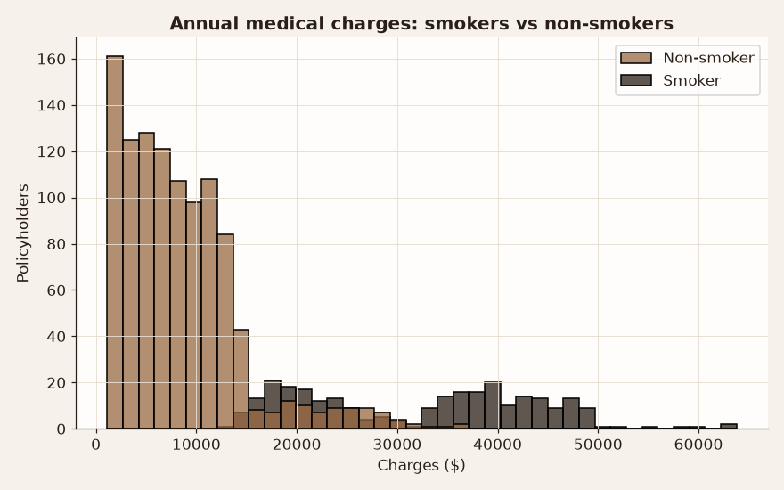
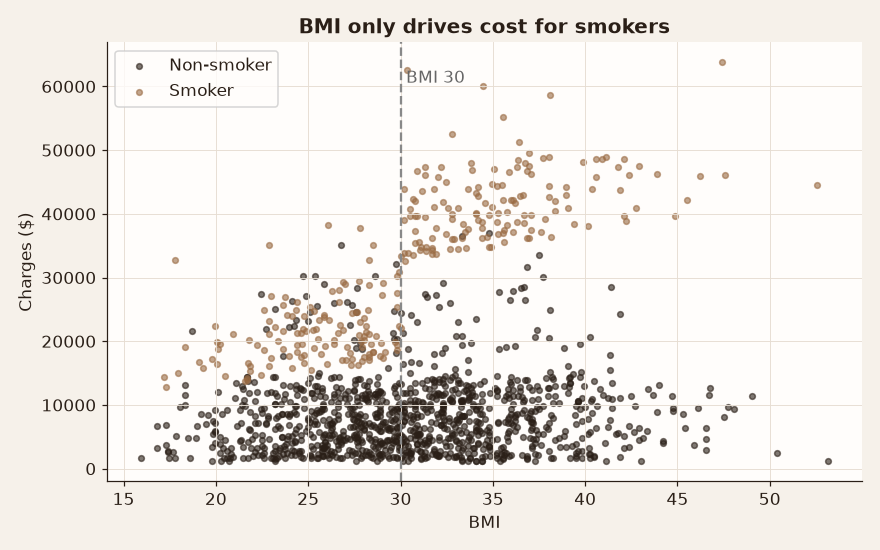
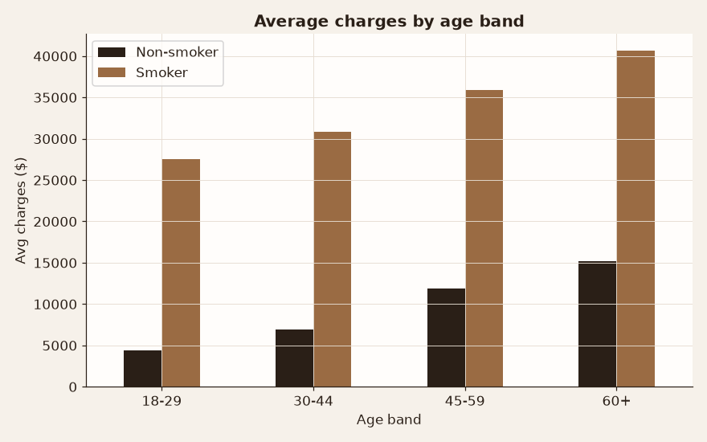

# What Really Drives Medical Insurance Costs?

**Business question:** An insurer wants to price policies fairly. Which customer traits (age, BMI, smoking, region, family size) actually move annual medical charges, and by how much?

## Data
- **Medical Cost Personal Dataset** (`insurance.csv`): 1,338 policyholders, 7 columns. It's 1,337 after removing one exact duplicate.
- Source: Brett Lantz, *Machine Learning with R*. It's mirrored at [GitHub (stedy/Machine-Learning-with-R-datasets)](https://github.com/stedy/Machine-Learning-with-R-datasets/blob/master/insurance.csv) and on [Kaggle](https://www.kaggle.com/datasets/mirichoi0218/insurance).
- License: published as a public teaching dataset. See the Kaggle listing for terms. The data is simulated from U.S. Census demographics, not real patients.

## Approach
1. **SQL (DuckDB)** (`sql/01_cost_drivers.sql`)
   - De-duplicates the rows and bands BMI and age with `CASE`.
   - Computes smoker × BMI segment averages and medians.
   - Ranks regions by average charges and computes each region's share of total spend with window functions.
   - Measures the smoker cost multiple with `FILTER` aggregates.
2. **Python** (`python/analysis.py`)
   - Runs one-sided Welch t-tests and Mann-Whitney U tests, with Cohen's d as the effect size.
   - Fits linear regression with a smoker × obese interaction and compares it to gradient boosting (scikit-learn), using a 75/25 holdout and 5-fold CV.
3. **R** (`r/analysis.R`) reproduces the tests and the interaction regression with `lm()`.

## Key results (from `python/results.json` and `r/run_output.txt`)
| Finding | Number |
|---|---|
| Smokers vs non-smokers, average charges | **$32,050 vs $8,441** (Welch p ≈ 6e-103, Cohen's d = 2.57) |
| Obese (BMI ≥ 30) vs others | $15,572 vs $10,714 (Welch p ≈ 1e-14, Mann-Whitney p ≈ 4.5e-5, d = 0.42) |
| Obese smokers, average | **$41,558**, about double non-obese smokers ($21,363) |
| Obese non-smokers, average | $8,856 vs $7,977. BMI barely matters without smoking |
| Linear model with interaction | test R² **0.88**, MAE **$2,481**, 5-fold CV R² 0.84 (R: adj. R² 0.863) |
| Gradient boosting | test R² 0.88, MAE $2,398. No better than the interpretable model |
| Smoker premium by age | 6.2× for ages 18–29, falling to 2.7× for 60+ |

**Takeaway:** smoking is the dominant cost driver, and BMI matters mainly *in combination with* smoking. A simple linear model with one interaction term explains about 84% of the variation and is as accurate as a black-box model, so it is the better pricing tool.

## Figures




## How to run
```bash
pip install -r requirements.txt
python python/analysis.py            # runs the SQL, tests, models, figures -> python/results.json
Rscript r/analysis.R                 # R version (needs dplyr)
duckdb < sql/01_cost_drivers.sql     # SQL alone (run from the project root)
```
